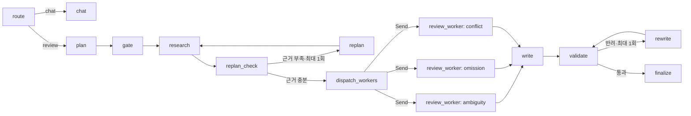

# SpecGuard Web MVP

기획서와 구현 명세서를 바탕으로 새 파일로 작성한 PC 웹 기반 요구사항 품질 검증 서비스다. 기존 `all_total_vue_student`는 수정하지 않는다.

## 제공 기능

- Vue 3 단일 페이지 요구사항 입력·결과·승인 UI
- FastAPI 동기 API와 SSE 실시간 진행 이벤트
- LangGraph `route → plan → gate → research → replan → dispatch → worker → write → validate → finalize`
- 의미 단서 기반 라우팅과 `needs_analysis` 이중 게이트
- 부족한 근거만 보완하는 최대 1회 동적 재계획
- 원문 근거·수정안·Given/When/Then 의미 Validator와 최대 1회 재작성
- MCP 일시 장애 retry/backoff와 fallback 규칙을 이용한 graceful degradation
- Ollama 선택 연동 시 fast/quality 모델 티어링, 미연동 시 결정적 fallback
- JSON 규칙·Markdown 프롬프트 외부화(코드 수정 없이 표현·심각도·비교 대상 확장)
- 원문 요구사항 ID 파싱과 주제·행위·단위가 같은 제약만 충돌 비교
- 실패 대상을 원문에서 추출하는 도메인 중립 누락 수정안
- `Send` API와 reducer를 이용한 모호성·누락·충돌 Worker 동적 fan-out/fan-in
- MCP Tool·Resource·Prompt 실제 호출
- 사용자 승인 이후에만 로컬 이슈 생성
- SQLite 검토·승인·이슈 저장
- SQLite thread 최종 checkpoint 저장·조회
- 30건 고정 데이터 기반 V1·V2 비교 스크립트

## 실행

```bash
cd specguard_web
python3 -m venv .venv
source .venv/bin/activate
pip install -r requirements.txt
python3 -m uvicorn server:app --host 127.0.0.1 --port 8600
```

브라우저에서 <http://127.0.0.1:8600>을 연다.

Ollama를 사용하려면 `.env.example`의 값을 환경변수로 설정하고
`SPECGUARD_USE_LLM=true`로 실행한다. 모델이 없거나 호출이 실패하면 로컬 규칙 경로로 복구한다.

## 테스트와 평가

```bash
pytest -q
python evaluate.py
```

## 주요 API

- `GET /health`
- `POST /reviews`
- `GET /reviews/stream`
- `GET /reviews/{review_id}`
- `GET /threads/{thread_id}/checkpoint`
- `GET /issues`
- `POST /reviews/{review_id}/approve`
- `POST /reviews/{review_id}/issues`

이슈 API는 승인되지 않은 finding에 대해 HTTP 409를 반환한다.

## LangGraph 처리 구조



세 Worker 결과는 `Annotated[list, operator.add]` reducer로 병합된다. 따라서 Python 함수 내부 병렬 호출이 아니라 각 Worker가 독립적인 LangGraph 실행으로 기록되고, 완료 후 `write` 노드에서 하나의 결과로 합쳐진다.
